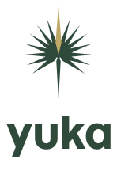
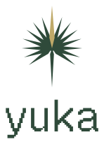
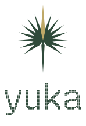
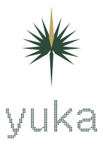
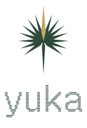

# Logo font options

Each image follows your GitHub theme: light or dark.

<table><tr>
<td align="center"><picture><source media="(prefers-color-scheme: dark)" srcset="momo-trust-display-dark.svg"></picture> Momo Trust Display</td>
<td align="center"><picture><source media="(prefers-color-scheme: dark)" srcset="geist-pixel-square-dark.svg"></picture> Geist Pixel Square</td>
<td align="center"><picture><source media="(prefers-color-scheme: dark)" srcset="geist-pixel-circle-dark.svg"></picture> Geist Pixel Circle</td>
</tr><tr>
<td align="center"><picture><source media="(prefers-color-scheme: dark)" srcset="geist-pixel-grid-dark.svg"></picture> Geist Pixel Grid</td>
<td align="center"><picture><source media="(prefers-color-scheme: dark)" srcset="geist-pixel-triangle-dark.svg"></picture> Geist Pixel Triangle</td>
<td align="center"><picture><source media="(prefers-color-scheme: dark)" srcset="geist-pixel-line-dark.svg"></picture> Geist Pixel Line</td>
</tr></table>
